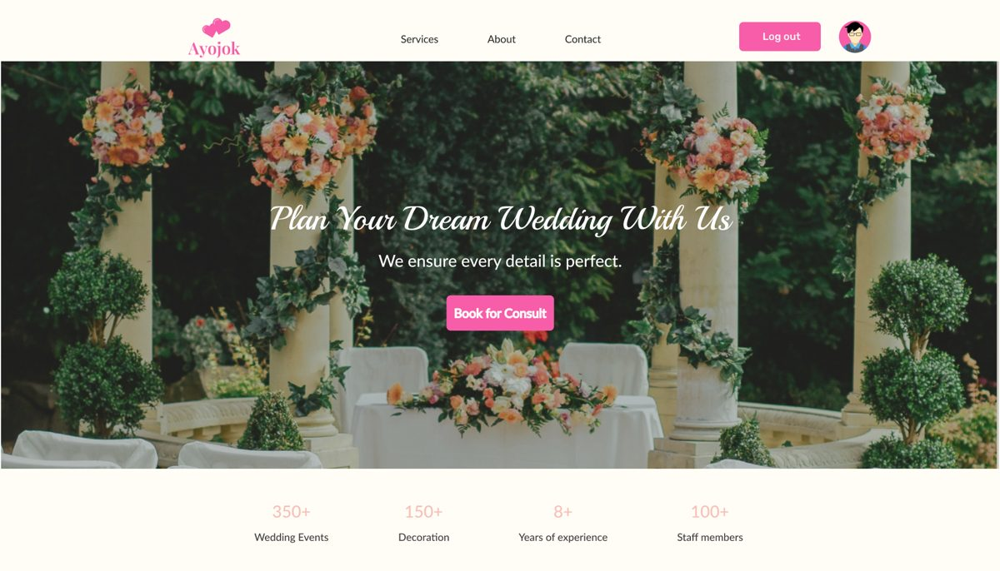

# Ayojok: Wedding & Event Planning Platform

**Live demo:** https://israfil0077.github.io/ayojok/

Ayojok brings wedding and event planning into one place: find vendors, plan the budget and book a consultation.
This website is a front-end version of the **AYOJOK 2.0 Figma design**, made for the System Analysis and Design
course at United International University. The design won **3rd Runner-Up at the UIU CSE Project Show, Summer 2025**.



## Pages

| Page | What it does |
|---|---|
| [Home](https://israfil0077.github.io/ayojok/) | Hero, highlights, vendor categories and ideas & tips, following the Figma design |
| [Services](https://israfil0077.github.io/ayojok/vendors.html) | Vendor list with category filters and a booking form |
| [Budget](https://israfil0077.github.io/ayojok/budget.html) | Working budget calculator that splits the total across categories |
| [Book for Consult](https://israfil0077.github.io/ayojok/consult.html) | Consultation booking form |
| [About](https://israfil0077.github.io/ayojok/about.html) and [Contact](https://israfil0077.github.io/ayojok/contact.html) | About the platform and a contact form |
| [Log in](https://israfil0077.github.io/ayojok/login.html) | Demo log-in that switches the header to the logged-in view |
| [Full design](https://israfil0077.github.io/ayojok/design.html) | All 42 screens of the Figma design (vendor pages, bookings, sign-up, dashboards, admin panels) in a full-size viewer |

This is a static demo: vendors are sample data and forms do not send anything.

## Built with

HTML, CSS and vanilla JavaScript, no build step. Colours, fonts and layout follow the Figma design
(cream `#FFFDF6`, pink `#F75DA8`, Playball and Lato). Images come from the design file.

## Run locally

Open `index.html` in a browser, or serve the folder:

```bash
python -m http.server 8000
```
